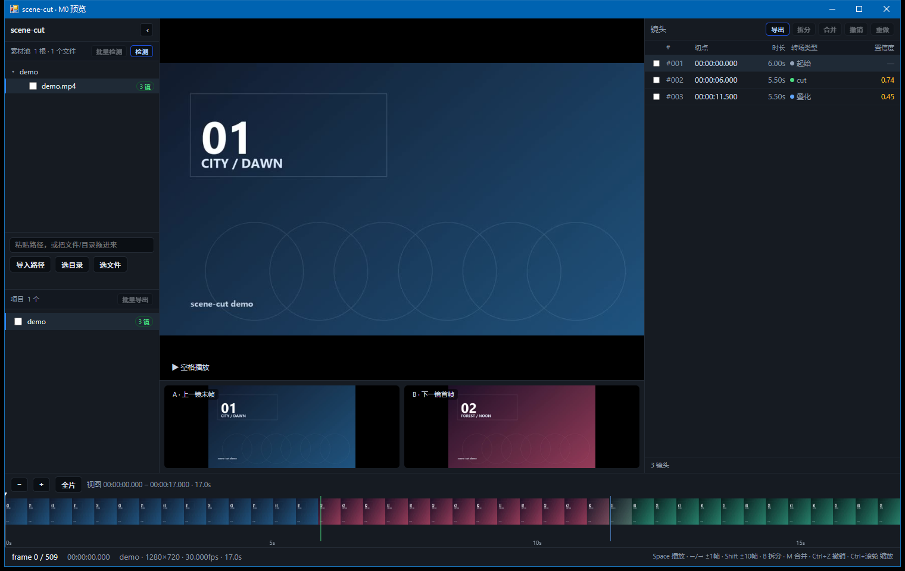
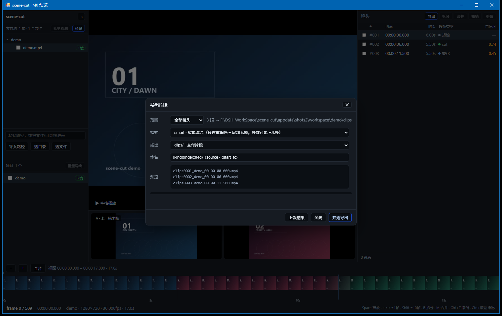

# scene-cut

[](https://github.com/Jimmy9511/scene-cut/actions/workflows/ci.yml)
[](LICENSE)

Shot-boundary detection and batch splitting for video: finds hard cuts and gradual
transitions frame-accurately, marks them, lets you review and fix boundaries on a
full-length timeline, then exports every shot as a separate file.

Built for **batch processing of short clips**: import a folder → detect → spot-check
and fix → export in one go.



## Features

| Capability | Implementation |
|---|---|
| Hard cut detection | PySceneDetect (ContentDetector + AdaptiveDetector, single pass) |
| Gradual transitions | TransNetV2 (dissolve / fade / wipe) |
| Candidate refinement | probability-peak alignment, strong-peak absorption, short-shot merging |
| Frame-level metadata | frame index, timecode, transition type, confidence |
| Review UI | zoomable timeline, filmstrip, A/B boundary compare, frame stepping |
| Editing | split, merge (multi-select), undo/redo, boundary nudging |
| Export | `copy` (stream copy) / `smart` (re-encode head) / `exact` (strict frame count) |
| Batch | pool-wide detection, batch export, CSV manifest with expected/actual frames |
| Desktop app | WebView2 window (WinForms host), min size 1200×780 |



## Usage

### Windows desktop build

```
scene-cut.exe               start server + open app window
scene-cut.exe --browser     open in default browser
scene-cut.exe --tab         open in an Edge window
scene-cut.exe --manual      copy URL to clipboard only
scene-cut.exe --no-open     server only (scripts / remote)
```

Data directory is chosen automatically: `SCENECUT_DATA` → `%LOCALAPPDATA%\SceneCut`
→ `data\` next to the exe → `%TEMP%\SceneCut`.

### From source

```powershell
python -m venv .venv
.\.venv\Scripts\python -m pip install -r requirements.txt
.\.venv\Scripts\python -m app.api.server --workspace workspace --port 8768
```

`ffmpeg` / `ffprobe` must be on `PATH` (or placed in `_internal\_bin\`).

## Build

```powershell
python tools\fetch_wheels.py ...      # offline wheels (Aliyun mirror)
python tools\fetch_webview2.py        # WebView2 managed SDK from NuGet
python tools\build_all.py             # PyInstaller + csc window host
python tools\package_release.py --version v0.9.0
```

The window host is an 8 KB C# WinForms app (`host/WindowHost.cs`) compiled with the
.NET Framework `csc.exe`; it renders in-process via the system WebView2 runtime.

## How it works

1. **T1 statistical** — PySceneDetect with Content + Adaptive in a single pass
2. **T2 neural** — TransNetV2 per-frame probabilities (custom 48×27 decode, CPU or GPU)
3. **T3 refine** — MSE / histogram / flash / subtitle cues inside candidate windows
4. **Fusion** — fused score plus black-frame, short-shot and strong-peak handling

Preview and export share the same boundary axis. The three export modes trade off
speed, quality and frame accuracy.

## Known limitations

- Gradual transitions anchor at the dissolve midpoint by default (`anchor=end` available)
- `copy` / `smart` inherit GOP/keyframe granularity (+4–5 frames), recorded as
  `expected` / `actual` in the manifest
- The desktop window requires the WebView2 runtime (bundled with Win10/11)

## License

MIT — see [LICENSE](LICENSE). Third-party notices: [THIRD_PARTY_NOTICES.md](THIRD_PARTY_NOTICES.md).

Do not redistribute GPL-built ffmpeg with this project; use an LGPL build.
torch is not bundled with the release archive.
