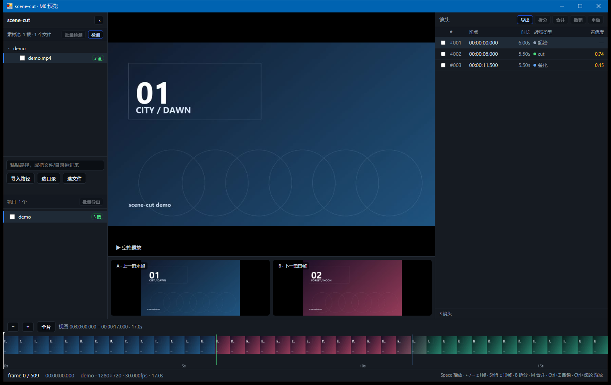
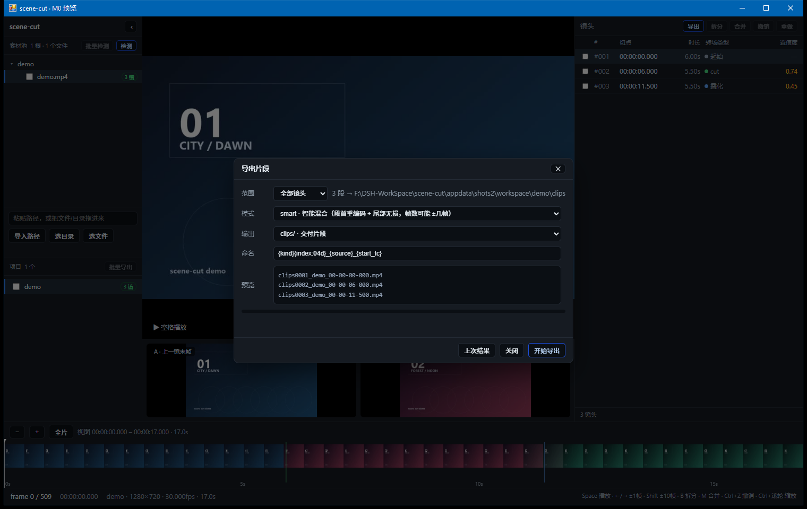

# scene-cut

[](https://github.com/Jimmy9511/scene-cut/actions/workflows/ci.yml)
[](LICENSE)

视频切镜（镜头边界）自动检测与批量切段工具：自动找出硬切与渐变转场所在帧，帧级标记，全片预览可人工改点，按镜头批量切段落盘。

英文说明见 [README.en.md](README.en.md)。

面向**短素材批量**处理：导入一批片子 → 自动检测 → 抽查修正 → 一键批量导出。



> 截图为内置演示素材（硬切 + 叠化），由 `python tools/make_demo_video.py` 生成。



## 功能

| 能力 | 实现 |
|---|---|
| 硬切检测 | PySceneDetect（ContentDetector + AdaptiveDetector，单遍） |
| 渐变转场检测 | TransNetV2（叠化 / 淡入淡出 / 划像） |
| 候选窗精修 | 概率峰对齐、强峰吸收、短镜头合并、黑场标记 |
| 帧级标记 | 帧号 + 时间码 + 转场类型 + 置信度 |
| 预览改点 | 可缩放时间轴、胶片条、A/B 边界对照、逐帧步进 |
| 编辑 | 拆分、合并（多选）、撤销/重做、边界微调 |
| 导出 | `copy`（流拷贝）/ `smart`（段首重编码）/ `exact`（严格帧数） |
| 批量 | 素材池批量检测、批量导出、清单 CSV（含期望/实际帧数） |
| 工程化 | 素材池 + 工作区分离；项目 JSON 可跨机复用 |

## 使用

### 桌面版（Windows）

双击 `scene-cut.exe`：启动本地服务，并打开一个独立应用窗口（WebView2 内嵌，最小尺寸 1200×780）。

```
scene-cut.exe              启动服务 + 打开窗口
scene-cut.exe --browser    用默认浏览器打开
scene-cut.exe --tab        用 Edge 普通窗口打开
scene-cut.exe --manual     只复制地址到剪贴板
scene-cut.exe --no-open    只启动服务（脚本/远程）
```

数据目录按顺序自动选择：`SCENECUT_DATA` → `%LOCALAPPDATA%\SceneCut` → 程序目录 `data\` → `%TEMP%\SceneCut`。

### 从源码运行

```powershell
python -m venv .venv
.\.venv\Scripts\python -m pip install -r requirements.txt

# 开发模式（浏览器访问 http://127.0.0.1:8768/）
.\.venv\Scripts\python -m app.api.server --workspace workspace --pool appdata\pool.json --port 8768
```

需要 `ffmpeg` / `ffprobe`（PATH 中，或放到 `_internal\_bin\`）。

## 日志与排障

检测、导出、编辑等操作都会写进**启动器的控制台窗口**，同时落到 `<数据目录>\logs\app.log`（2 MB 轮转，保留 3 份）。

级别（默认 `info`）：

| 级别 | 数值 | 内容 |
|---|---|---|
| `debug` | 10 | HTTP 请求、帧/切片请求、连接断开 |
| `detail` | 15 | 阶段细节：解码进度、候选数、每段导出耗时 |
| `info` | 20 | 用户行为 + 任务进度（**默认**） |
| `warning` | 30 | 可恢复异常：torch 缺失降级、作业取消 |
| `error` | 40 | 失败：检测/导出异常、未捕获错误 |

```
14:03:22 INFO    [detect] 开始 素材=demo.mp4 帧=510 fps=30 1280x720 预设=实拍短片 ai=on
14:03:24 INFO    [detect] t1 完成 1027ms 候选=1
14:03:25 DETAIL  [detect] decode 41% (210/510)
14:03:27 INFO    [detect] t2 开始 510 帧（预计 ≈6s，CPU 约 90 帧/秒）
14:03:33 INFO    [detect] 完成 3 镜头 用时 10232ms
```

四个修改入口（任选）：

```powershell
scene-cut.exe --log-level detail                       # 命令行
set SCENECUT_LOG_LEVEL=debug && scene-cut.exe          # 环境变量
# <数据目录>\settings.json → {"log_level": "detail"}    # 配置文件
# 界面底部状态栏「日志」下拉框                           # 运行时，立即生效
```

排障建议：**遇到检测卡住/很慢，先切到 `detail` 重跑一次**，控制台会显示当前阶段（`probe/t1/decode/t2/fuse`）、进度百分比与心跳，能直接看出卡在哪一步。

## 数据目录与工作区

数据分两层，都可以在界面里改（侧栏 **⚙ 设置**）：

| 项 | 内容 | 生效方式 |
|---|---|---|
| **数据目录** | 日志、缓存、素材池索引、`settings.json`、WebView2 缓存 | 改完需**重启程序**（设置里有一键重启） |
| **工作区目录** | 每个项目的文件夹（`project.json` / `analysis.json` / `clips` / `shots`） | **立即生效**，切换后可继续用旧项目（切回即可） |

数据目录的解析优先级：

```
--data-dir 参数  →  SCENECUT_DATA 环境变量  →  指针文件 data_root.txt
                 →  %LOCALAPPDATA%\SceneCut  →  程序目录\data  →  %TEMP%\SceneCut
```

`data_root.txt` 只有一行路径，放在 **exe 同目录**（源码模式在仓库根）。它必须留在稳定位置，不跟着数据搬走。

改数据目录时勾选「迁移现有数据」会把 `workspace/`、`appdata/pool.json`、`logs/`、`settings.json` **复制**到新目录（旧数据保留，确认无误后可自行删除）；迁移失败或中途取消时指针不写入，仍使用旧目录。

命令行等价物：

```powershell
scene-cut.exe --data-dir D:\SceneCut     # 临时指定数据目录（优先级最高）
```

## 性能

- 解码走 **ffmpeg 单遍**（`scale` 到灰度尺寸后一次读入），比原 cv2 两次 resize 快约 **12 倍**（1080p 实测 128 fps → 1529 fps）；ffmpeg 不可用时自动回退
- 长片可在设置里开「**AI 加速（抽帧）**」：超过阈值（默认 20000 帧）时隔帧推理再上采样，T2 时间大致减半，代价是渐变转场定位精度 ±N 帧（`analysis.json` 的 `run.t2_step` 有记录）
- 基准脚本：`python tools/bench_detect.py <video> [--fast]`，会对比 ffmpeg/cv2 两个解码引擎的耗时与切点

## 构建

```powershell
# 一次性拉取离线依赖（本机 PyPI CDN 不通时用阿里云镜像）
python tools\fetch_wheels.py scenedetect transnetv2-pytorch pyinstaller ...
python tools\fetch_webview2.py        # WebView2 托管 SDK（NuGet）

# 打包：PyInstaller（后端） + csc（WebView2 窗口宿主）
python tools\build_all.py
# => dist\scene-cut\scene-cut.exe
```

窗口宿主是 8 KB 的 C# WinForms 程序（`host/WindowHost.cs`），用系统自带的 .NET Framework `csc.exe` 编译，运行时依赖系统 WebView2 Runtime。

### 发布包

```powershell
python tools\package_release.py --version v0.9.0
# => release\scene-cut-v0.9.0-win64.zip + SHA256SUMS.txt + RELEASE_NOTES.md
```

### ffmpeg（分发合规）

随包分发的 ffmpeg 必须是 **LGPL** 构建（不含 x264/x265）：

```powershell
python tools\fetch_ffmpeg_lgpl.py   # 下载并放进 dist\scene-cut\_internal\_bin
```

开发机可以继续用系统里的 GPL 构建；但不要把它复制进发布产物。不随包提供 ffmpeg 时，只需在说明里要求用户自行安装。

## 工作原理

1. **T1 统计检测**：PySceneDetect 单遍挂 Content + Adaptive，给候选切点
2. **T2 神经检测**：TransNetV2 逐帧概率（自建 48×27 解码，可 CPU/GPU）
3. **T3 精修**：在候选窗内用 MSE / 直方图 / 闪光 / 字幕特征复核
4. **融合**：融合分数 + 黑场 / 短镜头 / 强峰吸收，输出边界与转场类型

预览与导出都基于同一份边界数轴；导出三档分别面向"速度优先 / 平衡 / 帧级精确"。

## 已知限制

- 渐变转场默认落在叠化中点，可用项目设置切到"叠化结束"锚点
- `copy` / `smart` 受关键帧与 GOP 边界影响，实际帧数会有 +4~5 帧偏差，清单里记录 `expected` / `actual`
- 窗口依赖 WebView2 Runtime（Win10/11 默认附带）

## 许可

代码 MIT，见 [LICENSE](LICENSE)。第三方组件与义务见 [THIRD_PARTY_NOTICES.md](THIRD_PARTY_NOTICES.md)。

发布二进制时不要附带 GPL 构建的 ffmpeg（请用 LGPL 构建）；torch 不随包分发。
